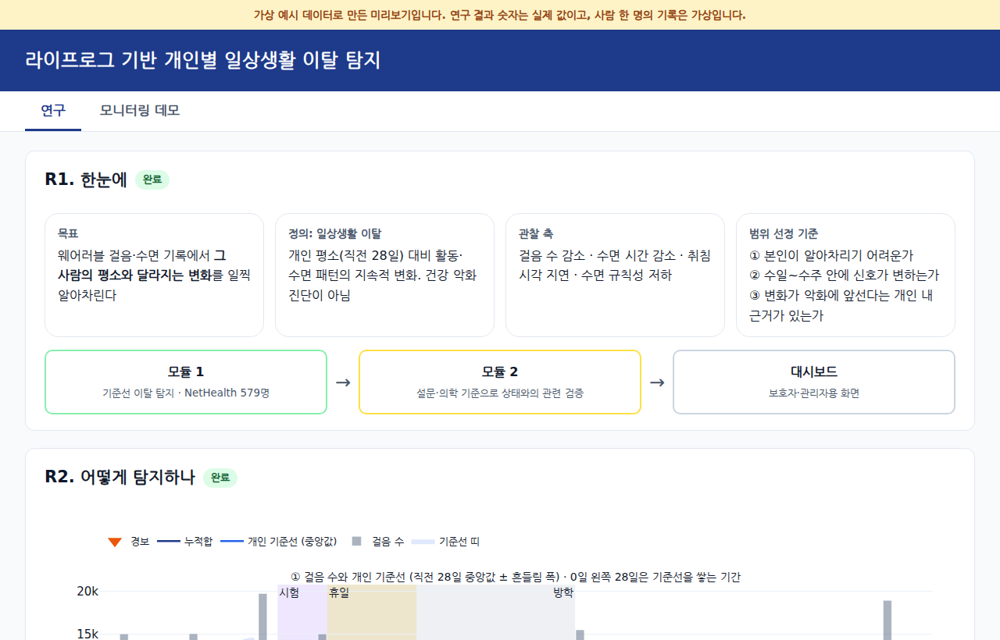
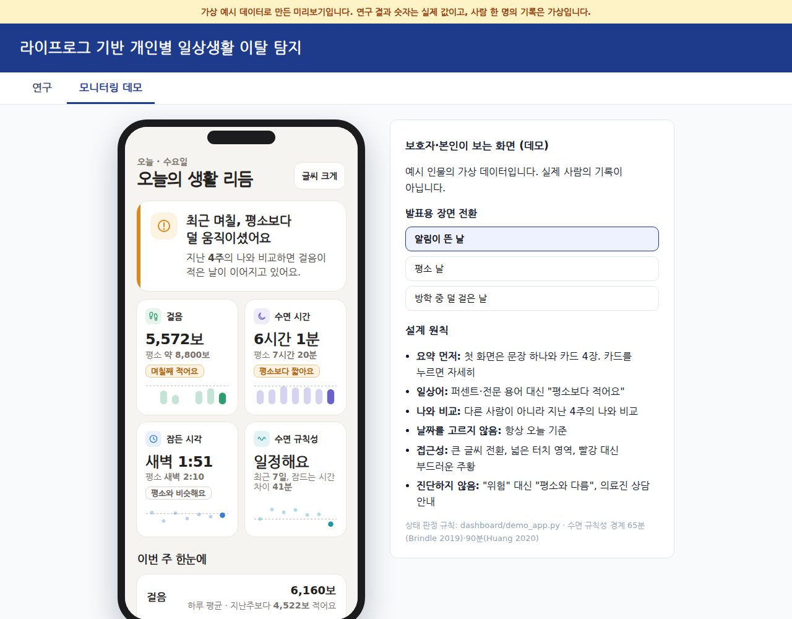
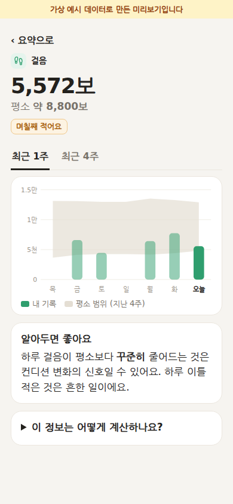

# capstone-lifelog

웨어러블·스마트홈 라이프로그로 개인 기준선 이탈을 감지하는 일상생활 붕괴 조기 탐지 (동국대 CSC종합설계)

- 팀: 김민준, 박고은, 조서연, 진승호
- 지도교수: 장혜령 교수님

## 프로젝트 개요
- **모듈 1. 기준선 이탈 탐지**: 개인의 과거 기록으로 "평소"를 만들고, 오늘이 평소에서 얼마나 벗어났는지 계산
- **모듈 2. 상태 판단**: 그 이탈이 실제 상태 악화와 관련 있는지 확인

## 코드 흐름 문서
- [docs/repo_structure.md](docs/repo_structure.md): 자료가 경보가 되기까지의 일곱 단계와 각 단계의 코드 위치, PR별로 추가된 지표·점수, 같은 조건에서 다시 측정한 결과 정리. 저장소를 처음 보는 사람은 이 문서부터 읽으면 됩니다.

## 대시보드
연구 결과와, 일반 사용자(본인·가족)가 휴대폰으로 보는 모니터링 화면 데모를 HTML 한 장에 담았습니다. 탭은 **연구**와 **모니터링 데모** 두 개입니다.

| 연구 탭 | 모니터링 데모 (PC 발표 화면) | 모니터링 데모 (휴대폰, 카드 상세) |
| --- | --- | --- |
|  |  |  |

- **미리보기 바로 보기:** [`dashboard/preview/dashboard.html`](dashboard/preview/dashboard.html), 휴대폰용 [`dashboard_모바일데모.html`](dashboard/preview/dashboard_모바일데모.html). 내려받아 브라우저로 열면 됩니다 (GitHub 화면에서는 소스로만 보임)
- 미리보기의 연구 결과 숫자는 실제 값이고, 사람 한 명의 기록은 **가상 예시 데이터**(`dashboard/sample_person.py`)입니다. NetHealth 참가자의 개인 기록은 공개 저장소에 올리지 않습니다
- 디자인·문구는 모두 코드에 있어서 누가 빌드해도 같은 화면이 나옵니다. 설계 원칙은 `dashboard/demo_app.py` 맨 위 설명 참고

```bash
pip install -r dashboard/requirements.txt                     # plotly (대시보드 전용)

# 미리보기 (데이터 없이 가능)
python3 -I dashboard/sample_person.py dashboard/preview/sample_person.json
python3 -I dashboard/build.py 미리보기 dashboard/preview/sample_person.json dashboard/preview/dashboard.html

# 발표용 (NetHealth 실제 참가자, 결과물은 커밋하지 않음)
python3 -I dashboard/export_person.py <저장할 json>
python3 -I dashboard/build.py 발표용 <json> <출력.html>
```
- 집계 숫자는 `dashboard/results_data.py` 한 곳에 출처와 함께 적혀 있습니다. 결과가 바뀌면 이 파일만 고치고 다시 빌드합니다

## 기술 스택
| 구분 | 사용 |
| --- | --- |
| 언어 | Python 3.12 |
| 분석 | pandas, numpy, scipy, scikit-learn |
| 시각화 | matplotlib, plotly (대시보드 전용) |
| 테스트 | pytest |
| 개발 환경 | VS Code + Jupyter Notebook |

## 폴더 구조
```
capstone-lifelog/
├── src/
│   ├── data_loader.py      # load_nethealth (+ Calendar.csv 있으면 study_week, term_tag, event_tag)
│   ├── preprocessing.py    # 중복 제거, 착용 필터, 수면 병합, 42일 필터, 요일 보정, 연구 기간 나누기
│   ├── baseline.py         # personal_z, group_z, rolling_mean, rolling_slope, cusum, bad_score
│   └── evaluation.py       # compare_alarms, 가짜 이탈 주입, 주입 평가, 결과표, log_result
├── notebooks/
│   ├── 01_preprocessing.ipynb        # 전처리 과정과 하루 표 확인
│   └── 02_baseline_nethealth.ipynb   # 개인 vs 집단 기준선 비교 + 주입 평가
├── experiments/            # PR별 실험 코드 (common.py, minjun/, integrated/)
├── dashboard/              # 결과 대시보드 (HTML 한 장 생성). preview/ = 가상 예시 데이터로 만든 미리보기
├── docs/                   # 코드 흐름 문서 repo_structure.md, 그림
├── tests/                  # pytest
├── data/                   # 데이터 (깃허브에 안 올림)
└── results/                # 실험 결과 기록 results.csv (깃허브에 안 올림)
```

## 설치
```bash
git clone https://github.com/2026-lifelog-analysis/capstone-lifelog.git
cd capstone-lifelog
pip install -r requirements.txt
```

## 데이터 준비 (NetHealth)
[NetHealth](https://sites.nd.edu/nethealth/)에서 받은 파일을 아래처럼 넣습니다. 파일 이름 앞부분만 맞으면 됩니다.
```
data/nethealth/
├── FitbitActivity(1-30-20).csv   # 하루 활동 (필수)
├── FitbitSleep(1-30-20).csv      # 수면 조각 (필수)
└── Calendar.csv                  # 학사 달력 (선택) — 있으면 study_week, term_tag, event_tag 열이 붙음
```
- `Calendar.csv` 형식 (NetHealth 원본 그대로): 주 단위 한 줄, 0~194주 (2015-08-16 ~ 2019-05-11)
  - 열: `Study Week, Begin Date, End date, Event, Beginning event date, End event date`
  - 날짜는 `20150823` 같은 숫자. 사건 날짜가 비어 있으면(Christmas, Orientation 등) 그 주 Begin~End 전체를 사건 기간으로 봄
  - Event 이름 표기가 제각각이라(Class begins/Classes begin, Final exams/Final exam, Mid-term/Mid-Term/fall/Spring break 등) 대소문자·단수/복수를 무시하고 같은 사건으로 처리함 (`dl.CAL_EVENTS`)
  - 파일이 없으면 세 열 없이 경고만 내고 진행함
- `data/`는 `.gitignore`에 있어서 커밋되지 않습니다. **데이터는 절대 커밋하지 않습니다**

## 사용법
```python
from src import data_loader as dl, baseline as bl, evaluation as ev

nh = dl.load_nethealth()                                            # 하루 한 줄 표
nh['p'] = bl.bad_score(bl.personal_z(nh, 'steps'), 'steps')         # 개인 기준선 ('클수록 나쁨')
nh['g'] = bl.bad_score(bl.group_z(nh, 'steps'), 'steps')            # 집단 기준선
ev.compare_alarms(nh, 'p', 'g')                                     # 라벨 없이 비교

res = ev.evaluate_injection(nh, 'steps', -0.3)                      # 걸음 30% 감소 주입 평가
ev.results_table(res)
```
노트북 02는 결과를 남길 때만 `WHO`를 내 이름으로, `SAVE = True`로 바꿔 실행 (기본은 `results/results.csv`에 기록 안 함)

테스트: 레포 맨 위에서 `pytest`

## 하루 표 열
| 열 | 뜻 |
| --- | --- |
| `pid`, `date` | 사람 ID(egoid), 날짜 |
| `steps` | 걸음 수 |
| `steps_per_hour` | 걸음 ÷ (24 × 착용률/100) |
| `active_min` | 움직인 시간(분) = lightly + fairly + very |
| `sleep_min` | 총 수면(분), 그날 조각 모두 합산 |
| `bed_min` | 잠든 시각, **정오부터 분** (23:30 → 690, 01:00 → 780) |
| `meanrate` | 하루 평균 심박 |
| `complypercent` | 착용률(%) |
| `dow` | 요일 (0=월 ~ 6=일) |
| `wake_min` | 일어난 시각, 18시부터 분 (07:00 → 780) |
| `n_episodes` | 그날 수면 조각 수 |
| `study_week` | 연구 주차 0~194 (`Calendar.csv`가 있을 때만. 아래 두 열도 같음, 달력 범위 밖 날은 빈칸) |
| `term_tag` | `학기` = 개강일 ~ 그 학기 기말고사 끝난 날, 나머지는 `방학` |
| `event_tag` | `개강주`(개강일부터 7일) / `시험`(기말고사) / `휴일`(break, Thanksgiving, Easter, Christmas) / `없음`. 겹치면 시험 > 휴일 > 개강주 |

## 전처리 규칙 (2026-10-13 회의 확정)
| # | 규칙 | 구현 |
| --- | --- | --- |
| 1 | 중복 제거: `(egoid, datadate)` 기준, 빈칸이 가장 적은 줄 하나만 (같으면 파일에서 먼저 나온 줄) | `pp.drop_duplicate_days` |
| 2 | 착용률 `complypercent` 80% 미만인 날은 활동·심박 값을 **빈칸(NaN)**으로 (0 아님). 수면은 유지 | `pp.build_activity(wear=80)` |
| 3 | 총 수면 `sleep_min` = 그날 수면 조각 **모두 합산** | `pp.merge_sleep` |
| 4 | 잠든 시각 `bed_min` = 90분 안에 이어지는 조각을 한 덩어리로 묶은 뒤, 가장 길게 잔 덩어리의 시작 시각 | `pp.merge_sleep(gap=90)`, `load_nethealth(sleep_gap=90)` |
| 5 | 잠든 시각 단위 = **정오부터 몇 분** (23:30 → 690, 01:00 → 780) | `pp.hms_to_min` |
| 6 | 개인 기준선 = 직전 **달력 28일** (기록 28줄이 아님). 빈 날은 빈칸으로 두고 계산, 창 안 기록 14일 이상일 때만 | `bl.personal_z(window=28, min_periods=14)` |
| 7 | 기록 있는 날(걸음 또는 수면)이 **42일 미만인 사람 제외** (기준선 28 + 평가 14) | `pp.filter_min_days(min_days=42)` |
| 8 | **빈칸 채우기(보간, ffill, bfill) 금지** (미래 정보 누출) | 어디에서도 안 함 |
| 9 | 이상치는 지우지 않고 **z를 ±8로 자름** | `personal_z(clip=8)`, `group_z(clip=8)`, `clip=None`이면 끔 |
| 10 | 방향 통일: "클수록 나쁨" (걸음↓, 활동↓, 수면↓, 잠든 시각↑, 심박↑) | `bl.bad_score`, `bl.BAD_DIRECTION` |
| 11 | 연구 기간 나누기: 지우지 않고 1~2학년(`before`) / 3~4학년(`after`)으로 나눠 돌릴 수 있게. 경계 `2017-08-13` = Calendar 104주차(3학년 오리엔테이션 주) 시작. 2학년 이후 참여 인원이 크게 줄어(NetHealth Table 1 Attrition Counts) 데이터 성격이 바뀌는 시점임. 기기 교체 날짜는 공식 문서에서 확인되지 않음 | `load_nethealth(period='all'\|'before'\|'after', cutoff=...)`, `pp.split_study_phase` |
| 12 | 경보 기준 = 오경보 사람당 30일 1회 = **3.3%** (`ALARM_RATE = 1/30`). 모든 사람에게 **같은 기준값 하나** | `ev.ALARM_RATE` |
| + | 요일 보정(선택): 기준선 창 안의 **과거** 값으로만 요일 평균을 구해서 뺌 | `personal_z(dow_adjust=True)` |

## 함수 목록
| 파일 | 함수 | 하는 일 |
| --- | --- | --- |
| `data_loader` | `load_nethealth` | 원본 → 하루 표 (위 규칙 전부 적용) |
| | `read_raw`, `load_calendar`, `add_term_tag` | 원본 읽기, 학사 달력 → 하루 표(study_week, term_tag, event_tag), 하루 표에 붙이기 |
| `preprocessing` | `hms_to_min`, `drop_duplicate_days`, `build_activity`, `merge_sleep` | 시각 변환, 중복 제거, 착용 필터, 수면 병합 |
| | `split_study_phase`, `filter_min_days`, `add_dow`, `dow_offsets` | 연구 기간 나누기, 42일 필터, 요일, 요일 보정값 |
| `baseline` | `personal_z` | 개인 기준선 z (달력 28일, ±8, 요일 보정 옵션) |
| | `group_z` | 집단 기준선 z (같은 날 30명 이상) |
| | `bad_score` | '클수록 나쁨'으로 방향 통일 |
| | `cusum`, `cusum_threshold` | 나빠지는 쪽 누적합 (허용치 `k`, 경보선 `h`), 3.3%가 되는 `h` 찾기 |
| | `rolling_mean`, `rolling_slope` | 달력 k일 평균, 기울기 |
| `evaluation` | `compare_alarms` | 라벨 없이 두 방법 비교 (같은 날 비율, 0번인 사람, 상위 10% 몫, 사람별 오경보율 분포) |
| | `inject_drift` | 가짜 이탈 주입 (크기, 길이, 갑자기/서서히, 시드 고정) |
| | `method_scores` | 비교 방법 5개 점수 (무작위, 단일 z, 개인, 개인+CUSUM, 집단) |
| | `evaluate_injection` | 주입 평가: 대조군, 공통 기준값, 사람별 탐지율·오경보율·차이·탐지 지연, PR-AUC(보조) |
| | `results_table`, `wilcoxon_table`, `plot_person_box` | 결과표, 방법 간 Wilcoxon 검정, 사람별 박스플롯 |
| | `log_result`, `log_table` | `results/results.csv`에 결과 기록 |

## 평가 방법 (모듈 1, 가짜 이탈 주입)
- 사람마다 정상 구간(직전 28일 기록 14일 이상, 구간 안 기록 7일 이상)을 무작위로 골라 **14일** 동안 지표를 바꿈 (예: 걸음 −30%, 잠든 시각 +120분)
- 구간 14일 안에 하루라도 울리면 **탐지**. 같은 구간을 주입 없이 한 번 더 돌린 **대조군**에서 울리면 **오경보**
- 기준값: 대조군 전체에서 하루 오경보율이 3.3%가 되도록 방법마다 **하나**
- 지표: 탐지율(주), 오경보율, 차이(Youden's J), **탐지 지연일수 중앙값**, PR-AUC(보조)
- **사람마다** 계산한 뒤 분포로 보고 (중앙값 + 박스플롯 + 방법 간 Wilcoxon). 정확도·F1·AUROC만 단독으로 쓰지 않음
- 오경보율은 두 가지: **하루 오경보율**은 기준값 정의상 3.3%, 결과표의 **오경보율**은 14일 구간 안에서 하루라도 울린 비율이라 더 크게 나옴 (탐지율과 같은 단위로 비교하기 위함)

## 브랜치 전략
| 브랜치 | 용도 |
| --- | --- |
| `main` | 항상 돌아가는 상태. PR로만 합치기 |
| `feat/<이름>-<작업>` | 새 기능·분석 |
| `fix/<이름>-<작업>` | 버그 수정 |
| `docs/<작업>` | 문서 수정 |

## 커밋 규칙
`<타입>: <내용>` (예: `feat: 수면 기준선 함수 추가`)

| 타입 | 언제 |
| --- | --- |
| `feat` | 새 기능·분석 |
| `fix` | 버그 수정 |
| `exp` | 실험 결과 추가 |
| `refactor` | 코드 정리 |
| `docs` | 문서 |
| `chore` | 설정 |

## PR 규칙
- 본문에 무엇을, 왜, 결과 적기
- 1명 이상 리뷰 후 merge
- 노트북은 충돌이 잦으니 각자 노트북 파일을 따로 만들어 작업
- 노트북은 **출력을 지우고** 커밋 (출력에 데이터 표가 들어가서)
- src/를 고치는 PR은 팀원 모두 확인 후 merge함

## 규칙
- `data/`, `results/`, `_archive/`는 커밋하지 않기 (`.gitignore`에 있음)
- 랜덤이 들어가는 곳은 시드 고정 (`ev.SEED = 0`)
- `src/`를 고치면 `pytest` 돌리기
