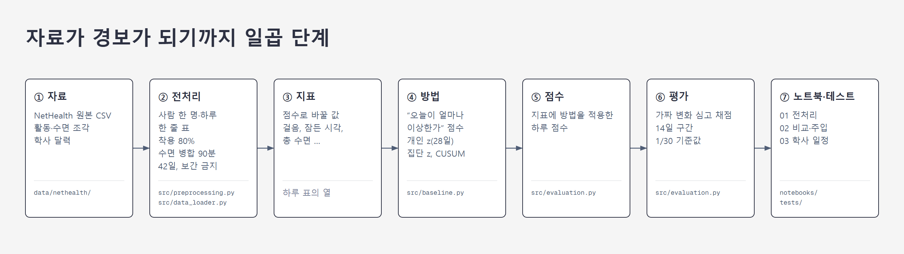
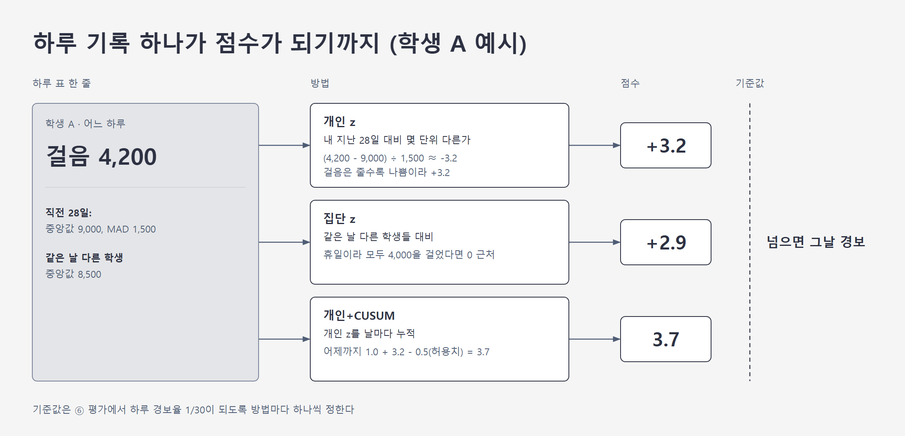

# 팀 저장소 구조 (capstone-lifelog)

이 저장소의 코드가 어떤 순서로 무엇을 하고, 각 단계에 어느 PR이 무엇을 보탰는지 정리한 문서다. 파일명을 누르면 해당 파일이 열린다. 2026-10-18 기준.

## 1. 전체 흐름

자료가 흐르는 순서대로 일곱 단계로 나뉜다.

| 단계 | 하는 일 | 코드 |
|---|---|---|
| ① 자료 | NetHealth 원본 CSV | `data/nethealth/` (깃에 안 올림) |
| ② 전처리 | 원본을 사람 한 명·하루 한 줄 표로 | [preprocessing.py](https://github.com/2026-lifelog-analysis/capstone-lifelog/blob/main/src/preprocessing.py), [data_loader.py](https://github.com/2026-lifelog-analysis/capstone-lifelog/blob/main/src/data_loader.py) |
| ③ 지표 | 점수로 바꿀 값을 고름 | 하루 표의 열, [regularity.py](https://github.com/2026-lifelog-analysis/capstone-lifelog/blob/main/experiments/minjun/regularity/regularity.py) |
| ④ 방법 | 지표 하나를 받아 "오늘이 얼마나 이상한가" 점수로 | [baseline.py](https://github.com/2026-lifelog-analysis/capstone-lifelog/blob/main/src/baseline.py) |
| ⑤ 점수 | 지표에 방법을 적용해 나온 하루 점수 | [evaluation.py](https://github.com/2026-lifelog-analysis/capstone-lifelog/blob/main/src/evaluation.py)의 `method_scores`, [common.py](https://github.com/2026-lifelog-analysis/capstone-lifelog/blob/main/experiments/common.py)의 `make_score_fn`, [regularity.py](https://github.com/2026-lifelog-analysis/capstone-lifelog/blob/main/experiments/minjun/regularity/regularity.py)의 `det_scores` |
| ⑥ 평가 | 점수에 기준값을 그어 경보로 바꾸고, 가짜 변화를 심어 채점 | [evaluation.py](https://github.com/2026-lifelog-analysis/capstone-lifelog/blob/main/src/evaluation.py)의 `evaluate_injection`. 점수 11개를 한 번에 채점하는 [run_all.py](../experiments/integrated/run_all.py) |
| ⑦ 노트북·테스트 | 돌려 보고 검사하는 곳 | [notebooks](https://github.com/2026-lifelog-analysis/capstone-lifelog/tree/main/notebooks), [tests](https://github.com/2026-lifelog-analysis/capstone-lifelog/tree/main/tests) |

- 공통 코드는 [src](https://github.com/2026-lifelog-analysis/capstone-lifelog/tree/main/src), 각자 작업은 [experiments](https://github.com/2026-lifelog-analysis/capstone-lifelog/tree/main/experiments)와 [notebooks](https://github.com/2026-lifelog-analysis/capstone-lifelog/tree/main/notebooks)에 있다.

---

## 2. 단계별 설명

### ① 자료

- 필수 파일 두 개. 하루 활동 파일(`FitbitActivity(1-30-20).csv`)에 걸음·활동 시간·심박·착용률, 수면 조각 파일(`FitbitSleep(1-30-20).csv`)에 잠든 시각·깬 시각.
- 학사 달력(`Calendar.csv`)은 선택. 있으면 하루 표에 연구 주차, 학기 여부, 개강주/시험/휴일 태그가 붙는다.

### ② 전처리

[data_loader.py](https://github.com/2026-lifelog-analysis/capstone-lifelog/blob/main/src/data_loader.py)의 `load_nethealth()` 한 번이 아래 규칙을 순서대로 적용한다. 함수는 모두 [preprocessing.py](https://github.com/2026-lifelog-analysis/capstone-lifelog/blob/main/src/preprocessing.py)에 있다.

| 규칙 | 내용 | 함수 |
|---|---|---|
| 중복 제거 | 같은 사람·같은 날이 여러 줄이면 빈칸이 가장 적은 줄 하나만 | `drop_duplicate_days` |
| 착용 필터 | 착용률 80% 미만인 날은 걸음·활동·심박을 빈칸으로. 수면은 유지 | `build_activity(wear=80)` |
| 수면 병합 | 90분 안에 이어지는 조각은 한 덩어리. 가장 긴 덩어리의 시작이 잠든 시각 | `merge_sleep(gap=90)` |
| 시각 단위 | 잠든 시각은 정오부터 센 분(01:00이면 780). 깬 시각은 18시부터 | `hms_to_min` |
| 최소 기록 | 기록 42일 미만인 사람 제외. 기준선 28일 + 평가 14일 | `filter_min_days(42)` |
| 빈칸 | 보간·앞뒤 채우기 금지. 미래 정보가 섞이기 때문 | 어디에서도 안 함 |

- 결과는 579명, 355,854줄.
- 그중 걸음과 수면이 모두 빈 줄이 42,403개(11.9%)라, 줄 수를 그대로 평가 표본 수로 읽으면 안 된다.
- [PR 2](https://github.com/2026-lifelog-analysis/capstone-lifelog/pull/2)가 공통 코드를 다시 돌려 같은 수를 확인했다.

### ③ 지표

- 공통 노트북이 쓰는 지표는 걸음(`steps`, 줄수록 나쁨), 잠든 시각(`bed_min`, 늦을수록 나쁨), 총 수면(`sleep_min`, 줄수록 나쁨) 셋이다.
- 심박과 활동 시간은 열만 있고 노트북 02에서는 쓰지 않는다. 방향은 [baseline.py](https://github.com/2026-lifelog-analysis/capstone-lifelog/blob/main/src/baseline.py)의 `BAD_DIRECTION`에 있다.
- [PR 3](https://github.com/2026-lifelog-analysis/capstone-lifelog/pull/3)의 [regularity.py](https://github.com/2026-lifelog-analysis/capstone-lifelog/blob/main/experiments/minjun/regularity/regularity.py)가 지표 하나를 추가했다. 잠든 시각과 깬 시각의 가운데(수면 중앙 시각)를 날마다 구하고, 그날 포함 최근 7일의 표준편차를 낸 값.
  - 7일 중 기록이 5일 미만이면 빈칸.
  - 위 세 지표가 "오늘 하루의 양이나 시각"이라면 이 값은 "최근 일주일이 얼마나 들쭉날쭉한가". 평균이 그대로여도 수면 시각이 흔들리면 움직인다.
- 예: 학생 A의 어느 날 줄에 걸음 4,200, 잠든 시각 900(새벽 3시), 총 수면 300분이 있고, 거기에 최근 7일 수면 중앙 시각 SD 65분이 하나 더 붙는다. 이 숫자들에는 아직 좋고 나쁨이 없다. 4,200걸음이 적은지는 A가 평소 얼마나 걷는지 알아야 안다.

### ④ 방법

지표 하나를 받아 점수를 만드는 함수들이다. 모두 [baseline.py](https://github.com/2026-lifelog-analysis/capstone-lifelog/blob/main/src/baseline.py)에 있다.

| 함수 | 하는 일 |
|---|---|
| `personal_z` | 직전 달력 28일의 내 중앙값·MAD로 오늘을 z점수로. 창 안 기록 14일 이상일 때만, z는 ±8에서 자름. `dow_adjust=True`면 창 안 과거 값으로 요일 보정 |
| `group_z` | 같은 날 다른 사람들(30명 이상)의 중앙값·MAD로 z |
| `bad_score` | 지표마다 다른 나쁜 방향을 "클수록 나쁨"으로 통일 |
| `cusum` | 나쁜 점수를 날마다 누적. S = max(0, S + 점수 − k). 경보선 h를 넘으면 경보 뒤 0으로. 빈 날은 S 유지 |
| `cusum_threshold` | 모든 사람·모든 날을 합쳐 경보율 1/30이 되는 h를 이분 탐색 |

- [PR 1](https://github.com/2026-lifelog-analysis/capstone-lifelog/pull/1)이 이 위에 변형을 추가했다.
  - [common.py](https://github.com/2026-lifelog-analysis/capstone-lifelog/blob/main/experiments/common.py)의 `personal_z_grouped`: 기준선 창 안에서 같은 요일(또는 평일/주말) 날의 평균을 빼고 z를 구함.
  - [final.py](https://github.com/2026-lifelog-analysis/capstone-lifelog/blob/main/experiments/final.py): 그 전에 그날 전체 학생의 걸음 중앙값을 먼저 뺌. CUSUM 허용치 k는 0.5에서 0.25로.
  - 공통 함수를 고친 게 아니라 바깥에서 감싼 것이라 공통 코드는 그대로.
- 예: 학생 A의 걸음 4,200을 개인 기준선 z에 넣으면, 직전 28일 중앙값 9,000·MAD 1,500일 때 (4,200 − 9,000) ÷ 1,500 ≈ −3.2. 방향을 맞추면 +3.2.
  - 집단 z는 같은 날 다른 학생 중앙값이 8,500이면 +2.9. 같은 4,200이라도 그날이 휴일이라 모두가 4,000을 걸었다면 0 근처.
  - CUSUM은 어제까지 쌓인 1.0에 오늘 3.2를 더하고 0.5를 빼서 3.7.

- 왼쪽이 하루 표 한 줄, 가운데가 방법 세 개, 오른쪽이 점수다. 기준값은 ⑥ 평가에서 방법마다 하나씩 정한다.

### ⑤ 점수

- 지표에 방법을 적용하면 하루 점수가 나온다. "걸음 + 개인 z", "걸음 + 개인+CUSUM", "잠든 시각 + 집단 z"처럼 조합마다 점수 열이 따로 생기고, 하나를 가리킬 때는 "걸음 개인+CUSUM 점수"처럼 부른다.
- 코드에서는 `method_scores(df, col)`가 그 자리다. `col`이 지표이고, 안에서 `personal_z`·`group_z`·`cusum`을 불러 돌려주는 표의 열 하나하나가 점수 열이다. PR 1의 `make_score_fn`과 PR 3의 `det_scores`도 같은 모양의 표를 만든다.
- 노트북 02가 비교하는 것은 [evaluation.py](https://github.com/2026-lifelog-analysis/capstone-lifelog/blob/main/src/evaluation.py)의 `method_scores`가 만드는 다섯 가지. 무작위(우연 수준 확인용), 단일 |z|, 개인 기준선, 개인 기준선 + CUSUM, 집단 기준선.
- PR이 추가한 점수:
  - [PR 1](https://github.com/2026-lifelog-analysis/capstone-lifelog/pull/1)의 [final.py](https://github.com/2026-lifelog-analysis/capstone-lifelog/blob/main/experiments/final.py): 걸음 개인+CUSUM의 변형 네 단계. 기본 → 요일 보정 → 같은 날 집단 중앙값 제거 → 최종(둘 다 + k=0.25). 걸음만 입력. 별도로 최근 7일 평균 대 앞 28일 평균 감소율 규칙([rule_baseline.py](https://github.com/2026-lifelog-analysis/capstone-lifelog/blob/main/experiments/rule_baseline.py)). "같은 날 집단 중앙값 제거"는 김민준 로컬 분석(저장소 밖)의 M3와 같은 계산.
  - [PR 3](https://github.com/2026-lifelog-analysis/capstone-lifelog/pull/3)의 [regularity.py](https://github.com/2026-lifelog-analysis/capstone-lifelog/blob/main/experiments/minjun/regularity/regularity.py): 수면 중앙 시각 7일 SD에 공통 개인 z와 개인+CUSUM을 붙인 것. 방법은 공통 그대로, 지표만 새것.
  - [PR 2](https://github.com/2026-lifelog-analysis/capstone-lifelog/pull/2)(미병합): 공통 코드와 별개로 만든 모델 여섯 개. 고정 14일·고정 28일·이동 28일 기준선, 양방향 CUSUM, 개발 기간 집단 기준선, 사전학습 모델 MOMENT의 복원 오차. 걸음·수면량·취침 시각 세 지표의 표준화 이탈 중 최댓값이 종합 점수.
- 한 줄로: PR 3은 지표만 바꿨고, PR 1은 방법만 바꿨으며, PR 4는 둘 다 그대로 두고 평가 쪽을 봤다.
- 공통 5개와 PR 1·3이 추가한 5개를 한 점수 함수로 묶어 공통 평가에 넣은 것이 [run_all.py](../experiments/integrated/run_all.py)다(3절).

### ⑥ 평가

정답 라벨이 없어서, 실제 기록에 가짜 변화를 심고 점수가 기준값을 넘는지로 채점한다. 함수는 [evaluation.py](https://github.com/2026-lifelog-analysis/capstone-lifelog/blob/main/src/evaluation.py)에 있다.

| 함수 | 하는 일 |
|---|---|
| `compare_alarms` | 정답 없이 두 방법 비교. 같은 날 겹치는 비율, 경보 0번인 사람 수, 상위 10% 사람의 경보 몫 |
| `inject_drift` | 사람마다 14일 구간 하나를 골라 가짜 변화를 심음. 구간은 직전 28일 기록 14일 이상, 구간 안 7일 이상인 곳에서 무작위. 비율(×0.7)이나 더하기(+120분), 갑자기나 서서히 |
| `evaluate_injection` | 심기 전 점수로 방법마다 기준값 하나(하루 경보율 1/30). 심은 뒤 14일 안에 경보 한 번이면 탐지, 같은 구간을 심기 전에 봤을 때 경보면 오경보. 사람별 탐지율·오경보율·차이·지연, 10회 반복 |
| `wilcoxon_table` | 방법끼리 사람 단위 짝 검정 |

- 공통 시나리오 넷: 걸음 −30%(갑자기, 서서히), 잠든 시각 +120분(갑자기, 서서히). 넷 다 값을 한쪽으로 미는 변화.
- PR이 추가한 평가:
  - [PR 4](https://github.com/2026-lifelog-analysis/capstone-lifelog/pull/4)의 [03_goeun_midterm.ipynb](https://github.com/2026-lifelog-analysis/capstone-lifelog/blob/main/notebooks/03_goeun_midterm.ipynb): 노트북 02 재실행 뒤, 학사 달력 태그로 휴일·개강 주·시험 주에 개인 기준선과 집단 기준선이 얼마나 울리는지. 휴일 걸음 경보가 개인 14.5%, 집단 1.6%. 발표 슬라이드 7쪽의 근거이고 김민준 로컬 분석과 같은 방향.
  - [PR 3](https://github.com/2026-lifelog-analysis/capstone-lifelog/pull/3)의 [run.py](https://github.com/2026-lifelog-analysis/capstone-lifelog/blob/main/experiments/minjun/regularity/run.py): 수면 시각 흔들림 시나리오. 14일 동안 잠든 시각·깬 시각에 날마다 SD 90분짜리 난수를 더하되 구간 평균은 0. 평균은 그대로고 흩어짐만 커지는 변화라 공통 시나리오로는 시험할 수 없던 유형. 채점은 공통 방식에 더해 14일 구간 오경보율 0.20 맞춤도 병기.
  - [PR 1](https://github.com/2026-lifelog-analysis/capstone-lifelog/pull/1)의 [final.py](https://github.com/2026-lifelog-analysis/capstone-lifelog/blob/main/experiments/final.py): 공통 평가 함수를 쓰되 사람을 70/30으로 나눠 70%에서 탐색, 30%에서 최종 평가. 시나리오는 걸음·수면·취침 동시 변화까지 다섯 개.
  - [PR 2](https://github.com/2026-lifelog-analysis/capstone-lifelog/pull/2): 가짜 변화 없이 실제 자료만으로, 시간순 40/30/30 분할에서 열 방법의 경보율과 집중도 비교.

### ⑦ 노트북과 테스트

- [01_preprocessing.ipynb](https://github.com/2026-lifelog-analysis/capstone-lifelog/blob/main/notebooks/01_preprocessing.ipynb) 전처리 확인, [02_baseline_nethealth.ipynb](https://github.com/2026-lifelog-analysis/capstone-lifelog/blob/main/notebooks/02_baseline_nethealth.ipynb) 개인 대 집단 비교와 주입 평가, [03_goeun_midterm.ipynb](https://github.com/2026-lifelog-analysis/capstone-lifelog/blob/main/notebooks/03_goeun_midterm.ipynb) 학사 일정 분석.
- 02와 03은 결과를 남길 때만 `WHO`와 `SAVE=True`를 바꿔 돌린다.
- [tests](https://github.com/2026-lifelog-analysis/capstone-lifelog/tree/main/tests)는 공통 24개 함수가 parametrize로 늘어 43개, PR 3이 5개 추가. main에서 48개 중 44 통과, 4 건너뜀(건너뜀은 공통 쪽).
- PR 1과 PR 4에는 테스트가 없다.

---

## 3. PR 1·3·4 점수를 한 평가에 넣은 결과

**공통 채점이 하는 일** (⑥ 평가, `evaluate_injection`)

- 사람마다 14일 구간을 하나 고른다. 직전 28일에 기록 14일 이상, 구간 안 7일 이상인 곳.
- 그 구간에 가짜 변화를 심는다. 걸음 −30% 또는 잠든 시각 +120분, 갑자기 또는 서서히.
- 점수 함수(`score_fn`)를 불러 심기 전·후의 하루 점수를 받는다.
- 점수마다 기준값을 하나 긋는다. 심기 전 전체 날에서 하루 경보율이 1/30이 되는 값.
- 구간 14일 안에 기준값을 넘는 날이 있으면 탐지, 심기 전 같은 구간에서 넘으면 오경보. 사람마다 탐지율·오경보율·차이를 낸다.
- 이 중 점수 함수만 바꿔 끼울 수 있다. 구간·심기·기준값·세기는 고정이다.

**각 PR이 한 것**

| PR | 점수 | 채점 | 공통 채점과 다른 점 |
|---|---|---|---|
| [1](https://github.com/2026-lifelog-analysis/capstone-lifelog/pull/1) | 걸음 개인+CUSUM 변형 3개 | 공통 `evaluate_injection`에 자기 점수 함수를 넣음 | 사람을 70/30으로 나눠 70%에서 고르고 30%에서만 채점. 기준값도 그 30%에서 정함 |
| [3](https://github.com/2026-lifelog-analysis/capstone-lifelog/pull/3) | 수면 중앙 SD 지표 2개 | 자기 스크립트. 구간·심기는 공통 함수와 같게, 기준값은 14일 구간 오경보율 0.20에 맞춤 | 기준값 규칙이 다름. 흔들림 시나리오는 공통 심기 함수가 못 만들어 자체 구현 |
| [4](https://github.com/2026-lifelog-analysis/capstone-lifelog/pull/4) | 공통 5개 | 공통 노트북 02 그대로 | 없음 |

- 세 PR의 숫자는 사람도, 기준값도 다르게 정한 값이다. PR 1의 탐지율 81%와 PR 3의 차이 0.26을 나란히 놓아도 누가 나은지 알 수 없었다.
- 2026-10-16 (금) 회의에서 "한 명이 넷을 모아 정리해 다시 올리자"고 한 것이 이 일이다.

**통합 방법** ([run_all.py](../experiments/integrated/run_all.py))

- 공통 `evaluate_injection`을 한 번 부른다. 사람·구간·심기·기준값 규칙이 전부 공통 조건이 된다.
- 점수 함수 자리에 열 11개짜리 함수를 넣는다. 공통 5개는 `method_scores` 그대로, PR 1 변형 3개는 `final.personal_bad`를 불러서, PR 3 지표 2개는 `regularity.sleep_mid_sd`를 불러서 만든다.
- 공통 코드와 PR 1·3 코드는 한 줄도 고치지 않았다. 함수를 불러 열을 옆에 붙였을 뿐이다.
- PR 1의 '레포 기본'은 공통 '개인 기준선 + CUSUM'과 같은 계산이라 넣지 않았다. 두 기반 점수가 전 행 일치(최대 차 0)하는지 검사로 확인했다.
- CUSUM 열은 경보선 h가 필요한데 공통 함수가 이 경로에서는 안 정해 준다. PR 1이 한 방식대로 심기 전 자료에서 열마다 h를 미리 구해 넣었다.
- 기준값 규칙을 PR 3 방식(구간 오경보율 0.20)으로 바꾼 표도 같은 11개에 대해 한 번 더 만들었다. 공통 함수에 그 규칙이 없어 PR 3의 채점 함수를 불렀다.
- PR 3의 흔들림 시나리오는 공통 심기 함수가 못 만든다. 구간은 공통 함수로 받고 PR 3의 `jitter_sleep`으로 흔든 뒤 같은 세는 법으로 셌다. 이 루프가 공통 함수와 같은 결과를 내는지 걸음 시나리오로 대조했다(10개 열 중 8개 일치, 2개는 0.002 이하 차이).
- 상세는 [RESULTS.md](../experiments/integrated/RESULTS.md).

**결과**

- 전원(걸음 562명, 잠든 시각·흔들림 564명), 공통 시나리오 4개 + PR 3 흔들림 1개, 반복 10회, 하루 경보율 1/30.
- 값은 차이(탐지율 − 오경보율)의 사람별 평균.

| 점수 | 걸음 −30% 갑자기 | 걸음 −30% 서서히 | 잠든 시각 +120분 갑자기 | 잠든 시각 +120분 서서히 | 수면 시각 흔들림 SD 90분 |
|---|---|---|---|---|---|
| 무작위 | 0.00 | 0.00 | 0.00 | 0.00 | 0.00 |
| 단일 z(\|z\|) | −0.12 | −0.07 | 0.08 | 0.05 | 0.13 |
| 개인 기준선 | 0.08 | 0.07 | 0.27 | 0.18 | 0.17 |
| 개인 기준선 + CUSUM | 0.35 | 0.19 | 0.57 | 0.43 | 0.14 |
| 집단 기준선 | 0.33 | 0.17 | 0.38 | 0.21 | 0.20 |
| PR1 +요일 보정 | 0.39 | 0.23 | 0.58 | 0.44 | 0.11 |
| PR1 +공통효과 제거 | 0.50 | 0.30 | 0.58 | 0.45 | 0.12 |
| **PR1 최종** | **0.51** | **0.32** | **0.59** | **0.46** | 0.09 |
| PR3 수면 중앙 SD 개인 z | 0.00 | 0.00 | 0.01 | 0.00 | 0.07 |
| **PR3 수면 중앙 SD 개인+CUSUM** | 0.00 | 0.00 | 0.02 | 0.00 | **0.26** |

- 걸음·잠든 시각이 움직이는 변화(왼쪽 4열): PR 1 최종이 1위. 특히 걸음에서 개인 기준선 + CUSUM보다 +0.17 높다. 잠든 시각에서는 차이가 거의 없다.
- 수면 시각 흔들림(오른쪽 열): PR 3 지표가 1위(0.26). PR 1 변형은 0.1 안팎으로 떨어진다.
- 즉 PR 1은 평균이 움직이는 변화, PR 3은 평균은 그대로인 흔들림을 본다. 서로 다른 변화라 한쪽이 다른 쪽을 대신하지 못한다.
- 기준값 규칙을 구간 오경보율 0.20(PR 3 방식)으로 바꿔도 순위는 같다.

---

## 4. 조건 차이와 못 넣은 것

- **PR 1의 참고 집단.** PR 1은 주입 없는 70%를 참고 집단으로 두고 그날 중앙값을 구했다. 통합에서는 전원이 평가 대상이라 참고 집단이 없고, 그날 중앙값에 심은 변화가 조금 섞인다. 사람마다 구간이 달라 같은 날 겹치는 사람은 적다.
- **PR 1 변형을 잠든 시각·흔들림에도 적용했다.** PR 1 본문은 걸음만 평가했다. 그 두 열은 통합에서 처음 돌린 값이다.
- **흔들림 시나리오는 별도 루프다.** 공통 `inject_drift`가 평균 0 난수 흔들림을 못 만들어, PR 3의 `jitter_sleep`으로 심고 같은 세는 법으로 셌다. 걸음 시나리오로 대조하면 공통 함수와 10개 열 중 8개가 일치하고 PR 1 변형 2개만 0.002 이하 차이가 난다. 공통 함수 한 번 호출로 나온 값은 아니다.
- **[PR 2](https://github.com/2026-lifelog-analysis/capstone-lifelog/pull/2)는 못 넣었다.** 공통 점수 함수 모양이 아닌 모델 6개이고, 가짜 변화 평가가 없다. PR 2는 아직 열려 있다.
- **CUSUM 기준값.** 공통 함수는 `score_fn` 경로의 모든 열을 분위수로 긋는다. CUSUM 안의 초기화선 h와 그 분위수는 조금 다를 수 있다(PR 2 실측: 방법당 1인일). 구간 오경보 0.20 방식은 h 자체를 맞추고, 두 방식의 순위가 같다.
- **같은 자료의 재분석.** 네 PR과 같은 NetHealth이고 반복 탐색에 쓰인 자료다. 독립 검증이 아니다.

---
